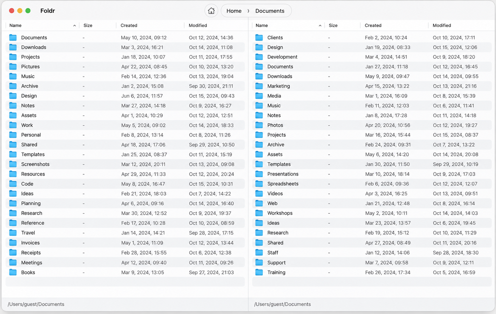

# Foldr

A little more room for your files. Foldr is a two-pane file manager for macOS that makes space for a better way to work.

[Download Foldr](https://github.com/timokhin/foldr-releases/releases/latest) · [Website](https://timokhin.github.io/foldr-releases/) · [Issue tracker](https://github.com/timokhin/foldr-releases/issues)

## Native and lightweight

Built for macOS for a fast, native experience that stays light on your system. Foldr takes about **10 MB** of disk space and uses little RAM.

## Features

- **Two panes, one flow:** Keep two folders side by side and drag files between them.
- **Preview as you go:** View files without leaving your workspace; switch the right pane between files and preview.
- **Make it yours:** Customize settings and context menu commands to make everyday work more familiar.

## License

See the [Foldr Software License Agreement](license.md).
